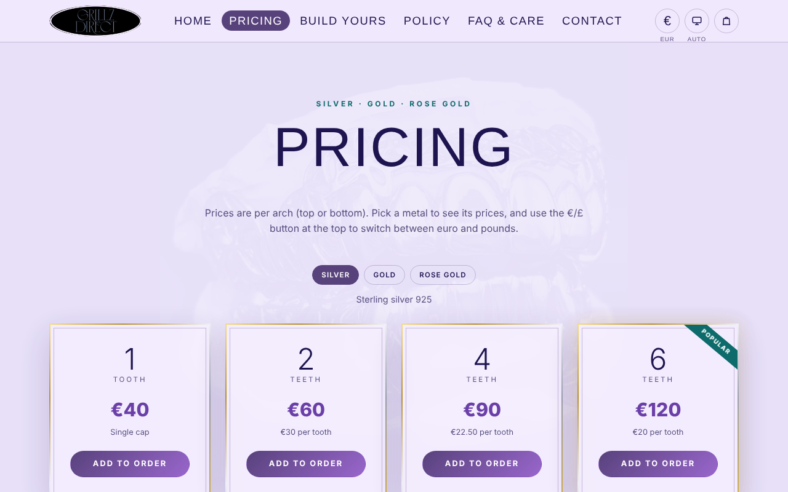
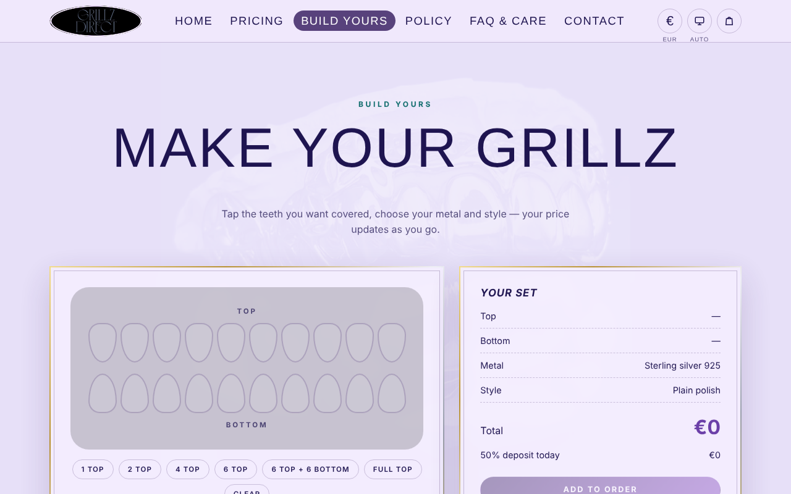
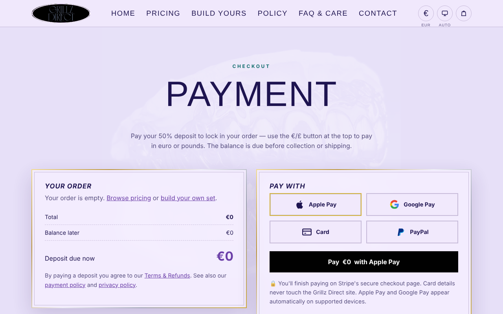

# Grillz Direct: E-commerce Website

A live online shop for my grillz business, where customers build a custom set, see the price update as they go, and pay a 50% deposit online.

**Live site:** [grillzdirect.netlify.app](https://grillzdirect.netlify.app/)
**Personal project:** I designed, built, deployed and run it myself.

---

## Purpose

Customers used to ask for prices one by one over messages. I wanted a site where they can see clear prices, design their own set and pay a deposit securely, without me handling card details.

## Features

- **Custom-order builder:** tap the teeth you want covered, then pick the metal (sterling silver, 9ct gold, 9ct rose gold) and style. The price updates live.
- **Pricing per metal and currency:** each metal has its own price table, in EUR or GBP, switched with a currency button.
- **Online deposits:** a 50% deposit through Stripe Checkout (card, Apple Pay, Google Pay or PayPal).
- **Business pages:** pricing, FAQ and aftercare, order policy, contact form, privacy policy and terms.
- **SEO:** sitemap, `robots.txt` and Google Search Console verification.

## Security decisions

| Risk | What I did |
|---|---|
| Customer edits the price in the browser | Prices are **recalculated on the server** (`netlify/lib/shop.mjs`). The browser only sends what was chosen, never the amount |
| Leaked API keys | The Stripe secret key lives in **environment variables** only. `.env` is git-ignored, and only `.env.example` (with no values) is in this repo |
| Handling card data | Payment happens on **Stripe's hosted checkout page**, so card details never touch my site |
| Fake payment notifications | The local server verifies Stripe **webhook signatures with HMAC-SHA256** and a constant-time compare (`server.py`) |
| Oversized or junk requests | Request bodies are size-limited, and currency, payment method and items are checked against allow-lists |

## Technologies

HTML · CSS · JavaScript · Python (local server, standard library only) · Netlify (hosting and serverless functions) · Stripe Checkout · Git and GitHub

## Screenshots

| Home | Pricing |
|---|---|
|  |  |

| Build your own set | Payment |
|---|---|
|  |  |

## Project structure

```
├── index.html, shop.html, custom.html, ...   # site pages
├── css/style.css, js/main.js                  # styling and front-end logic
├── netlify/functions/checkout.mjs             # creates the Stripe Checkout session
├── netlify/functions/confirm.mjs              # confirms payment for the thank-you page
├── netlify/lib/shop.mjs                       # server-side price list and validation
├── server.py                                  # local development server (+ webhook check)
└── netlify.toml                               # Netlify build settings
```

## Run it locally

```bash
cp .env.example .env        # add your own Stripe test key (sk_test_...)
python server.py            # then open http://localhost:8000
```

## What I learned

How to take payments without storing card data, why prices must be checked on the server, how to keep secrets out of a public repo, and how to deploy with serverless functions.

---

[← Back to my portfolio](https://github.com/Dani-Kunda)
